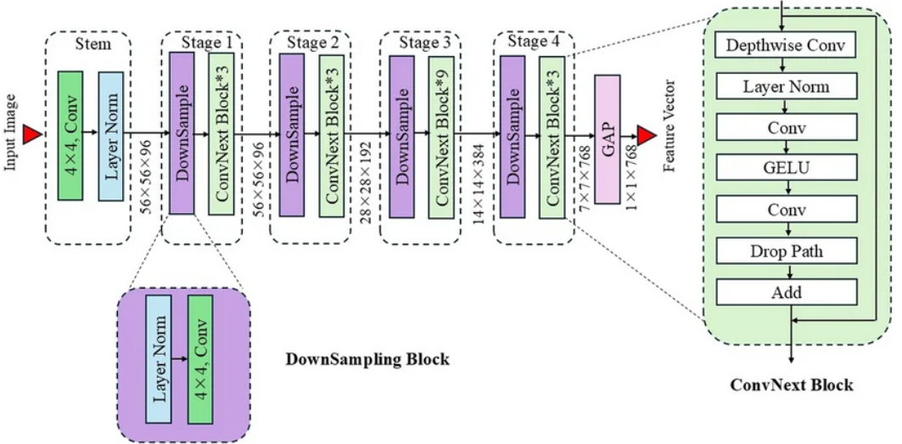
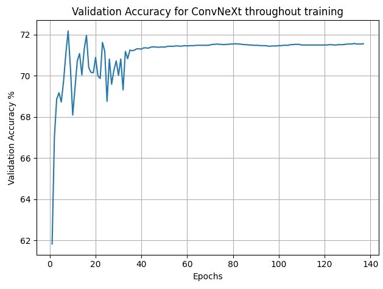
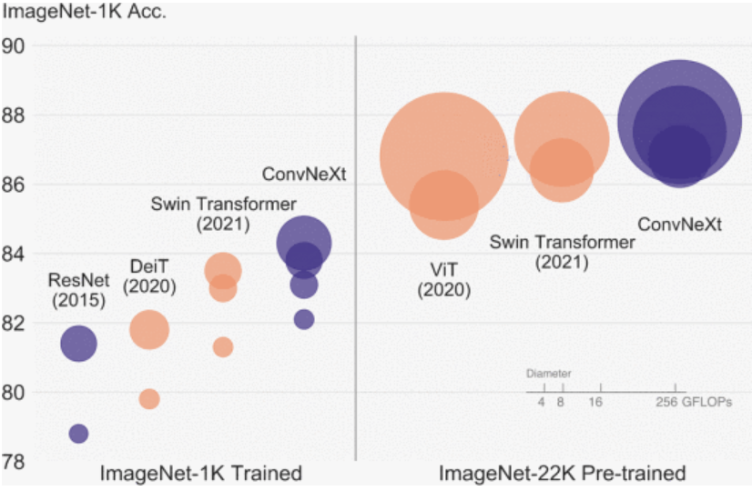

# ADNI classification using ConvNeXt model

Alzheimer's Disease (AD) is a progressive neurodegenerative brain disorder that causes rapid decline in a person's cognitive abilities. Living with such disease is difficult, but early diagnosis has been found to cause significant improvements to the lives of those with the disease, as well as helping family to prepare for future decline. Thus, it was proposed a ML model to help catch early signs of AD would be helpful in a clinical setting. 

ConvNeXt is a modern convolutional neural network (CNN) that takes many of the successful design elements of Vision Transformers and Swin Transformers to build upon ResNet, helping to outperform all existing computer vision models before it. The key innovations adapted to ResNet to create ConvNeXt include:

1.	Inverted Bottleneck Blocks - expansion occurs before depth wise convolution. More effective for resource constrained environments
2.	Layer Normalisation instead of Batch Normalisation 
3.	Convolutions are reduced to 4x4 with a stride of 4 to mimic the patch embedding of ViTs - this means patches no longer overlap
4.	Four stage structure processing feature maps with decreasing resolution - this matches the compute distribution in Swin Transformers
5.	Depth wise separable convolutions reduce the computational cost by decreasing the number of parameters and the calculations required for each convolution - model can become deeper and wider without increasing computational cost

Here, we aim to explore its capabilities, building a model to help diagnose Alzheimer's disease through MRI brain scans. Main goals are to build a model that is fast enough to use in real time to assist doctors, quick to train, and accurate enough to provide confident predictions.

#### Model Architecture Diagram 

Architecture of ConvNeXt-Tiny model (Gupta, 2025)

Please refer to my feasibility review at the end of this file where I describe my planned approach for my model, including the decision to use the ConvNeXt-Tiny for my model architecture.

## Preparing the dataset
ADNI is a publicly available dataset containing MRI brain scans, classified into 3 categories: Cognitively Unimpaired, Mild Cognitive Impairment and Alzheimer's Disease. To make classification simpler, Cognitively Unimpaired was labelled as 0 (Normal Control), and Mild Cognitive Impairment and Alzheimer's Disease was grouped labelled 1 (Alzheimer's Disease) - the resulting data being a binary classification task. Since each patient provides multiple brain scans within the dataset, a random split almost guarantees data leakage. 

Already, the provided dataset on Rangpur is divided into a rough 70/30 test/train split with no patient leakage. To further acquire a hold-out set (from now referred to as the test set) and separate validation set, the test folder on Rangpur was split to acquire a rough 50/20/30 split for the train/validation/test sets. This is done in dataset.py. The two folders are loaded in, remapped to have the correct labels (AD = 1, NC = 0), and the train folder split by paient id to a rough 2/3 for validation, and 1/3 for test. These sets are then each transferred to a DataLoader to be used throughout training and evaluation of the model. 

The validation set will be used throughout training to quire feedback on the model's performance on unseen data, helping to fine tune hyperparameters and model architecture. Thus, the test set is imperative as a final evaluation to ensure the model performs well on unseen data.

We also run a quick assertion on the two new acquired sets to ensure the script to split the sets contains no patient data leakage.

## Baseline model - basic CNN classifier

Before running the ConvNeXt model a basic CNN model was run on the dataset to use as a comparitive baseline, deomonstrating the improvement of ConvNeNt. This model was taken from the 3710 blackboard, and tweaked slightly to be compatible with the ADNI dataset and classifcation task. The results are displayed below. 

| Evaluation Metric | Value | Computational Cost | Value |
|---|---:|---|---:|
| Accuracy | 74.18% | Peak GPU VRAM | 2881.41 MiB |
| Precision | 72.77% | Parameter count | 75,138 |
| Recall | 74.36% | Inference latency | 0.342 ms |
| F1 Score | 0.7356 | | |
| AUCROC | 0.817 | | |

#### Confusion Matrix

The baseline model perfomed averagely, with an f1 score of 0.73. This is reflected in the confusion matrix, which shows a high level of misclassified patients. More detrimentally, the model predicted apprroximately 17% of patients to be NC who in fact had Alzheimer's Disease. This result is incredibly alarming, as false negatives are considerable more damaging than false positives to the health of patients who incorrectly receive this information.

However, considering the complexity of the images, simplicity of the model, and a training time of only 18.37 minutes, this result is not abysmal. Training was cut short at ~18 minutes due to a plateau in the model's performance, which is evident in the graph above. The model reached it's peak accuracy at around 55 epochs, and plateued most likely due to too high of a learning rate and the vanishing gradient problem, which is a common issue for models such as this with no skip connections. Computational metrics were well in the bounds of target values, and thus it is expected that a more advanced model with more parameters and a longer training time will be able to reach the desired level of performance. 

## ConvNeXt - First training run 

#### Evaluation Metrics

| Evaluation Metric | Value | Computational Cost | Value |
|---|---:|---|---:|
| Accuracy | 71.84% | Peak GPU VRAM | 4733.92 MiB |
| Precision | 69.84% | Parameter count | 29,299,778 |
| Recall | 73.4% | Inference latency | 5.314 ms |
| F1 Score | 0.7157 | Model size | 112 MiB |
| AUCROC | 0.7758 | | |

#### Confusion Matrix

Despite the new model having considerably more parameters and complexity, the model performed worse than the baseline. Model's accuracy oscillates drastically before plateuing at epoch ~35, maintaining a steady ~71% accuracy for the rest of the hour of training. This could be caused by several factors:

1. The learning rate is set too high, meaning the model makes large jumps during gradient descent, potentially overshooting local minimum or finding itself stuck in a flat, local minimum that pleateus learning.
2. Training set is too small and does not represent a wide enough distribution of key features, which translates to poor performance on unseen data 
3. The learning rate scheduler has dropped the learning rate too drastically around this point, meaning weights cannot make large changes and the model becomes stuck in a sub-optimal solution.
4. Architecture severely overfitting - this is extremely likely due to the loss of the model reaching 0.0000 by the last epoch. This suggests the model has simply memorised the training data causing it to generalise poorly

## Further experimentation and findings 

After this training run, several ideas for improvements were formulated and different experiments were run to see what made an improvement to training. Additionally, the training accuracy was also recorded throughout to observe if the model was overfitting to the training data. 

Experiments include:
1. Reduce the learning rate - if the model is falling into a sub optimal solution, a reduced learning rate could assist with more accurate adjustments
2. Change optimiser to AdamW with weight decay of 0.05 - this will hopefully provide more effective regularisation which will assist if the model is overfitting
3. Increasing the size of the training set. A 70/20/10 for train, validate and test could provide more than enough images for unseen assessments while increasing the data available to train the model
4. Reducing the complexity of the model - the ConvNeXt-Tiny architecture has over 27 million parameters, and for a small dataset of only several thousand images, it's very likely the model has simply memorised the training set, consequently not learning any real features causing it to perform poorly on unseen data.
5. Data augmentation - if the model is overfitting, augmenting the training set could help the model be more robust, learning general features rather than memorising the training set which would help with generalisation.

## Final Model - ConvNeXt reduced architecture with training data augmentation

After the success of the reduced 

## Further Experimentation

Earlier experiments, including reducing the learning rate and optimiser, were done on the ConvNeXt-Tiny architecture which was severely overfitting the training data. Since the model was updated later in the process to be a much simpler architecture with less trainable parameters, these experiments should be revisited again to see if they assist with the model's training. However, due to time constraints this was not revisited in this process. 

## Failure Case Autopsy & Manager Recommendations

## Artificial Intelligence Usage Disclosure

## References 
Gupta, P., Vadgaonkar, N., Nirmal, J., & Mehendale, N. (2025). A hybrid CNN–ViT framework for skin disease classification via feature extraction and selection. Neural Computing and Applications, 37(32), 27151–27177. https://doi.org/10.1007/s00521-025-11664-x

# Feasibility Review - AD Diagnosis with ConvNeXt Model
### User Need, Scope & Acceptance Criteria

Alzheimer’s disease is often difficult to detect and diagnose in its earliest stages. Possible early diagnoses would drastically improve conditions for patients, by reducing anxiety caused by previously unexplained symptoms, allowing families to plan, enabling patients to prioritise their health, helping to preserve cognitive function, seek support and available resources. Thus, it is proposed a ML model could assist doctors with early diagnosis, providing a prediction, alongside how confident the model is of its decision. It is noted that false negatives are significantly more damaging than false positives, and the model should aim to reduce occurrences of this more than achieving an extremely high accuracy. The model will aim to have the following:
1.	F1 score > 0.8  (> 0.9  as extension if this is too easy for the model)
2.	Able to train in < 60 minutes to allow for multiple experiments to easily occur
3.	Model size <= 150 MB to allow for easy saving and deployment
4.	Peak VRAM of 8 GB
5.	< 1ms of latency

### Model Choice & Course Concepts

I will be making a ConvNext model (difficulty hard) to classify the ADNI dataset. I will not use pretrained weights, and will implement the ConvNext-tiny model, since a baseline smoke test already showed a basic CNN managed to > 0.7 f1 score in 18 minutes of training, thus I am confident the tiny model will be sufficient to gain an f1 score > 0.9 in an hour of training. This model has 4 stages, each with respectively 3, 3, 9, and 3 blocks. Each stage will have 96, 192, 384, and 768 channels per stage respectively. I will use Cross-Entropy loss, and the final layer will be a fully connected neural layer using a sigmoid activation function to classify, since there are only 2 classes. This also automatically gives me the confidence of the models’ prediction. Data will be split into 2 groups, AD and NC, and separated into 3 datasets – test, validation and train. There will be no patient crossover between sets to avoid data leakage. 
ConvNext is an extension of ResNet-50, adapting techniques used in Vision and Swin Transformers to enhance the model. The paper “A ConvNet for the 2020” shows the model vastly out-performs these competitors, as seen in figure 1.  

### Preliminary Feasibility Evidence

The training set up has been run with a basic CNN model to test collection of statistics is feasible and to ensure the data set up is accurate ready for ConvNext. After 50 epochs of training, the model already had an F1 score of 0.7356 in 18.5 minutes of training, a latency of 0.342 milliseconds, a max of 2.8 GB of VRAM used during training. Thus, I am confident the success criteria can be met by ConvNext. 

### Risks & Fallback

Key risks are the model takes a significant amount of time to train and fails to achieve the success criteria to provider reliable diagnosis. If so, the model shall be simplified, for example implementing ResNet-50 instead. This is likely to be successful as a basic CNN already showed significant results in a short period of training. 

### References
Liu, Z., Mao, H., Wu, C.-Y., Feichtenhofer, C., Darrell, T., & Xie, S. (2022). A ConvNet for the 2020s. 2022 IEEE/CVF Conference on Computer Vision and Pattern Recognition (CVPR), 11966–11976. https://doi.org/10.1109/cvpr52688.2022.01167

### Appendix

