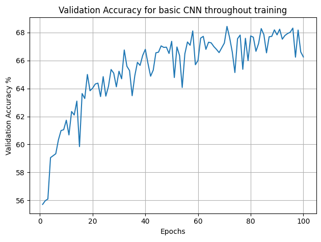
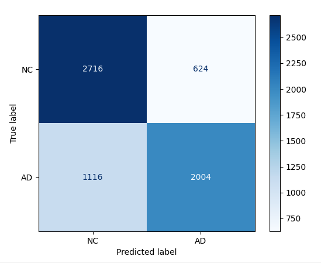
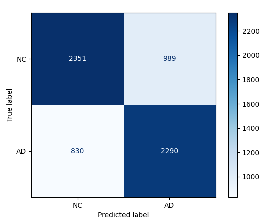

# ADNI classification using ConvNeXt model
Helping to diagnose Alzheimer's disease using MRI brain scans.

ConvNeXt is a modern convolutional neural network (CNN) that takes many of the successful design elements of Vision Transformers and Swin Transformers to build upon ResNet, helping to outperform all existing computer vision models before it. Here, we aim to explore it's capabilities, building a model to help diagnose Alzheimer's disease through MRI brain scans. Main goals are to build a model that is fast enough to use in real time to assist doctors, quick to train, and accurate enough to provide confident predictions.

## Preparing the dataset
ADNI is a publicly available dataset containing MRI brain scans, classified into 3 categories: Cognitively Unimpaired, Mild Cognitive Impairment and Alzheimer's Disease. To make classification simpler, Cognitively Unimpaired was labelled as 0 (Normal Control), and Mild Cognitive Impairment and Alzheimer's Disease was grouped labelled 1 (Alzheimer's Disease) - the resulting data being a binary classification task. Since each patient provides multiple brain scans within the dataset, a random split almost guarantees data leakage. 

Already, the provided dataset on Rangpur is divided into a rough 70/30 test/train split with no patient leakage. To further acquire a hold-out set (from now referred to as the test set) and separate validation set, the test folder on Rangpur was split to acquire a rough 70/20/10 split for the train/validation/test sets. This is done in dataset.py. The two folders are loaded in, remapped to have the correct labels (AD = 1, NC = 0), and the test folder split by paient id to a rough 2/3 for validation, and 1/3 for test. These sets are then each transferred to a DataLoader to be used throughout training and evaluation of the model. 

The validation set will be used throughout training to quire feedback on the model's performance on unseen data, helping to fine tune hyperparameters and model architecture. Thus, the test set is imperative as a final evaluation to ensure the model performs well on unseen data.

We also run a quick assertion on the two new acquired sets to ensure the script to split the sets contains no patient data leakage.

## Baseline model - basic CNN classifier

Before running the ConvNeXt model a basic CNN model was run on the dataset to use as a comparitive baseline, deomonstrating the improvement of ConvNeNt. This model was taken from the 3710 blackboard, and tweaked slightly to be compatible with the ADNI dataset and classifcation task. The results are displayed below. 

#### Evaluation Metrics

| Metric    | Value |
|-----------|------ |
| Accuracy  | 74.18% |
| Precision | 72.77% |
| Recall    | 74.36% |
| F1 Score  | 0.7356 |
| AUCROC | 0.817 |

#### Computational Cost

| Metric    | Value |
|-----------|------:|
| peak GPU VRAM  | 2881.41 MiB |
| parameter count | 75,138 |
| inference latency | 0.342 ms |

#### Confusion Matrix

The baseline model perfomed averagely, with an f1 score of 0.73. This is reflected in the confusion matrix, which shows a high level of misclassified patients. More detrimentally, the model predicted apprroximately 17% of patients to be NC who in fact had Alzheimer's Disease. This result is incredibly alarming, as false negatives are considerable more damaging than false positives to the health of patients who incorrectly receive this information.

However, considering the complexity of the images, simplicity of the model, and a training time of only 18.37 minutes, this result is not abysmal. Training was cut short at ~18 minutes due to a plateau in the model's performance, which is evident in the graph above. The model reached it's peak accuracy at around 55 epochs, and plateued most likely due to too high of a learning rate and the vanishing gradient problem, which is a common issue for models such as this with no skip connections. Computational metrics were well in the bounds of target values, and thus it is expected that a more advanced model with more parameters and a longer training time will be able to reach the desired level of performance. 

## ConvNeXt - improved results

#### Evaluation Metrics

| Metric    | Value |
|-----------|------:|
| Accuracy  | 71.84% |
| Precision | 69.84% |
| Recall    | 73.4% |
| F1 Score  | 0.7157 |
| AUCROC | 0.7758 |

| Metric    | Value |
|-----------|------:|
| peak GPU VRAM  | 4733.92 MiB |
| parameter count | 29,299,778 |
| inference latency | 5.314 ms |
| model size | 112 MiB |

#### Confusion Matrix

Despite the new model having considerably more parameters and complexity, the model performed worse than the baseline. After inspection, a few key things were missing. Firstly, since the model's accuracy oscillates drastically before plateuing at epoch ~35, maintaining a steady ~71% accuracy for the rest of the hour of training. This could be caused by several factors:

1. The learning rate is set too high, meaning the model makes large jumps during gradient descent, potentially overshooting local minimum or finding itself stuck in a flat, local minimum that pleateus learning. 
2. The learning rate scheduler has dropped the learning rate too drastically around this point, meaning weights cannot make large changes and the model becomes stuck in a sub-optimal solution.
3. Architecture is underfitting (less obvious as to how to combat this issue)

Another small thing that effects learning is the size of the training set. Due to the original 

## Failure Case Autopsy & Manager Recommendations
